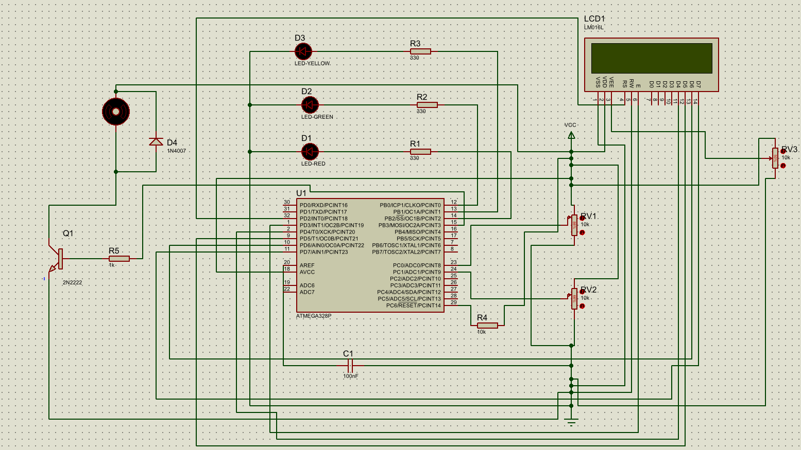
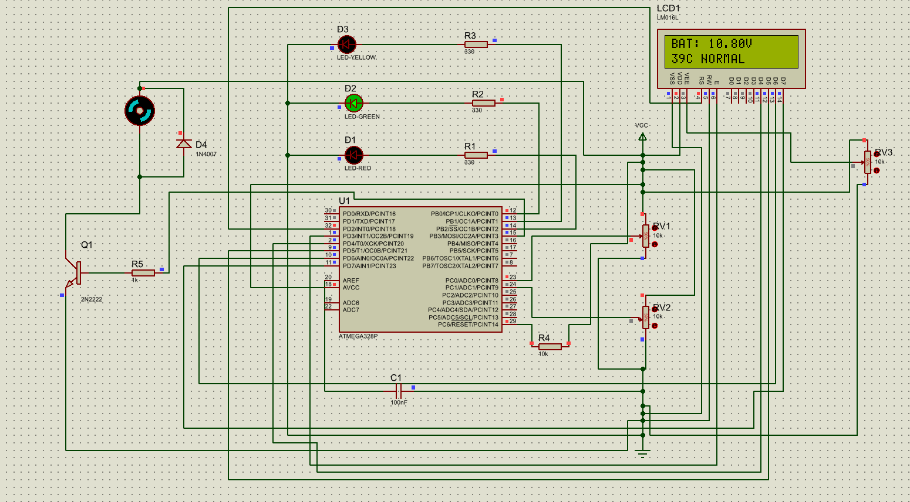
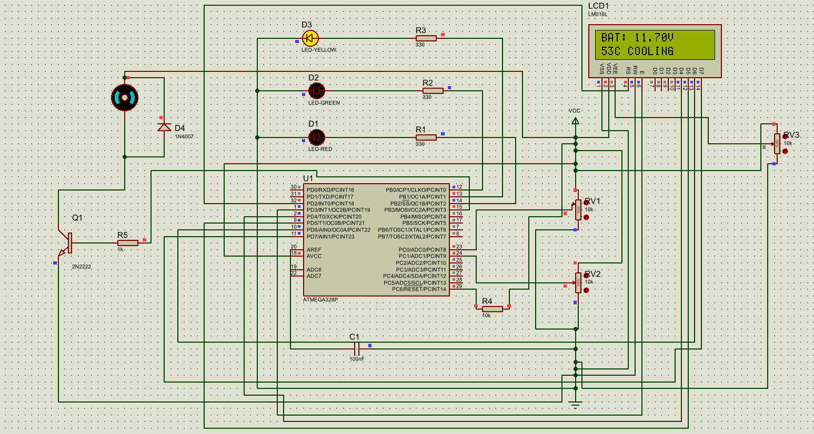
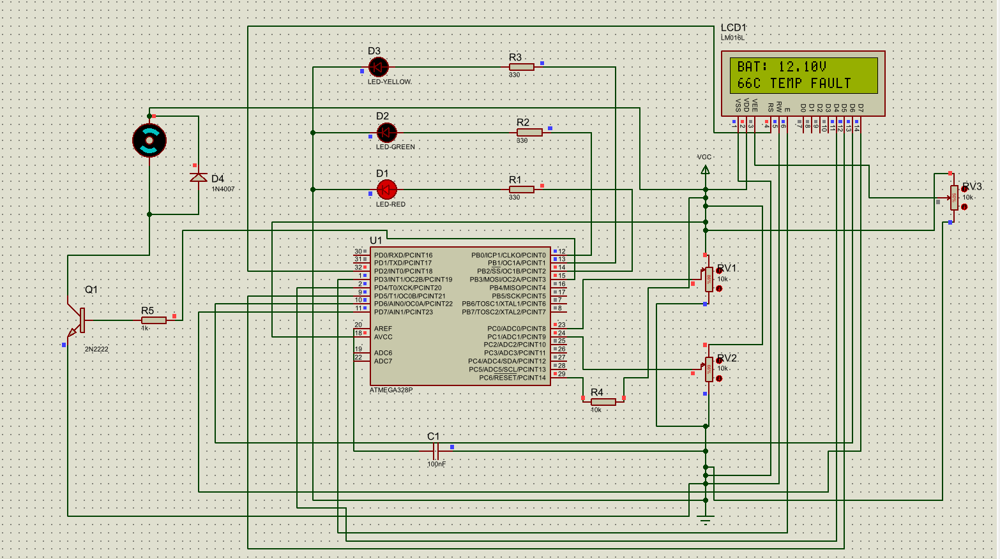

# Smart Battery Management System with PWM-Based Automatic Cooling

A simulation-based embedded Battery Management System (BMS) controller developed using **ATmega328P, Embedded C, AVR-GCC, and Proteus 9**.

The project demonstrates simulated battery monitoring, real-time LCD display, fault detection, and temperature-dependent cooling fan control.

## Project Overview

The system uses an ATmega328P microcontroller to monitor simulated battery voltage and temperature through its Analog-to-Digital Converter (ADC).

Based on the monitored conditions, the controller updates a 16×2 LCD, activates status LEDs, and controls a DC cooling fan using PWM.

## Technologies Used

- Embedded C
- ATmega328P Microcontroller
- Proteus Design Suite 9
- AVR-GCC Compiler
- VS Code
- ADC, GPIO, Timer2 PWM, LCD Interfacing

## Key Features

- Simulated battery voltage monitoring (9.0–12.6V)
- Simulated temperature monitoring (0–100°C)
- Real-time 16×2 LCD display
- Overvoltage and undervoltage fault detection
- Overtemperature fault indication
- Green, yellow, and red status LEDs
- Automatic cooling fan control
- Temperature-dependent PWM fan control implemented using Timer2

## System Architecture

**Voltage Simulator + Temperature Simulator → ATmega328P → LCD + LEDs + PWM Cooling Fan**

## Pin Configuration

| Component | ATmega328P Pin |
|---|---|
| Battery voltage input | PC0 / ADC0 |
| Temperature input | PC1 / ADC1 |
| Green LED | PB0 |
| Yellow LED | PB1 |
| Red LED | PB2 |
| PWM cooling fan | PB3 / OC2A |
| LCD RS | PD2 |
| LCD Enable | PD3 |
| LCD D4–D7 | PD4–PD7 |

## Automatic Cooling Logic

| Temperature | PWM Duty Cycle | Status |
|---|---|---|
| Below 40°C | 0% | NORMAL |
| 40–49°C | 30% | COOLING |
| 50–59°C | 60% | COOLING |
| 60°C and above | 100% | TEMP FAULT |

### Battery Fault Conditions

- Undervoltage: Below 9.6V
- Overvoltage: Above 12.3V
- Overtemperature: 60°C or above

These thresholds are for simulation and learning purposes.

## Proteus Simulation

### Complete Circuit



### Normal Condition



### Cooling Mode



### Temperature Fault



## Build Instructions

Compile the firmware using AVR-GCC:

```bash
avr-gcc -mmcu=atmega328p -DF_CPU=8000000UL -Os -Wall -o main.elf main.c
avr-objcopy -O ihex -R .eeprom main.elf main.hex
```

Load `main.hex` into the ATmega328P in Proteus and configure the simulation clock to 8 MHz.

Run the simulation and adjust the potentiometers to observe different battery and temperature conditions.

## Project Structure

```text
firmware/       Embedded C source and HEX firmware
proteus/        Proteus schematic and simulation project
screenshots/    Circuit and simulation results
README.md       Project documentation
```

## Limitations

This is an educational, simulation-based BMS controller, not a physical battery protection system. Sensor values are generated using potentiometers, and the design does not implement cell balancing or a validated hardware battery-disconnection circuit. PWM firmware is implemented, but duty-cycle performance requires separate waveform verification.

## Future Improvements

- Individual battery-cell monitoring
- Current sensing
- State-of-charge estimation
- Cell balancing
- Automatic load disconnection
- Fault logging and IoT monitoring
- PCB design using Altium Designer

## Author

**Vinay R**

Electronics and Communication Engineering

GitHub: https://github.com/vinu678d-lgtm
